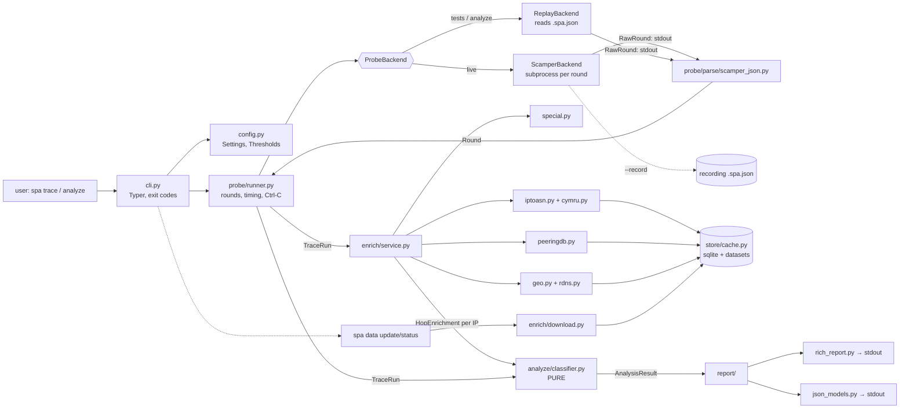

# Architecture

This page shows how the parts fit together. The behavior of each part is in the specs under
[`spec/`](spec/), and the reasons are in the [ADRs](decisions/README.md).

## Components and data flow



Sequence for `spa trace`: parse flags, load config, resolve target, preflight (scamper and
privileges), N rounds (each: spawn, communicate, parse, flow check, optionally record), enrich unique
responder IPs, classify (pure), render, exit with the code mapped from the verdict.
`spa analyze` is identical except that rounds come from `ReplayBackend` and there is no preflight.

## Module layout

```text
src/smart_path_analyzer/
  __init__.py            __version__
  __main__.py            python -m smart_path_analyzer
  cli.py                 Typer app; flags → Settings; exceptions → exit codes; the only sys.exit
  config.py              Settings + Thresholds from defaults ← TOML ← env ← flags
  errors.py              SpaError hierarchy with exit_code
  models.py              all shared dataclasses and enums (docs/spec/data-model.md)
  probe/
    runner.py            run_trace(spec, backend, clock, on_round) -> TraceRun
    recording.py         read/write .spa.json, scrub source address
    backends/
      base.py            ProbeBackend Protocol, BackendCapabilities, RawRound
      scamper.py         ScamperBackend, build_argv(), preflight()
      replay.py          ReplayBackend
    parse/
      scamper_json.py    parse_round(raw, spec) -> Round (pure)
  enrich/
    service.py           Enricher: orchestrates lookups per unique IP
    special.py           special-range table → AddressClass
    iptoasn.py           dataset convert + bisect lookup
    cymru.py             Team Cymru DNS (dnspython)
    peeringdb.py         sync + exact/prefix lookup
    geo.py               DB-IP MMDB reader (maxminddb)
    rdns.py              PTR lookup + IATA hint parser
    download.py          urllib conditional downloads, atomic replace
    data/iata.csv        small built-in airport table
  analyze/               PURE: imports only stdlib + models
    thresholds.py        Thresholds dataclass, DEFAULT_THRESHOLDS
    stats.py             wilson, newcombe, median_ci, p90, jitter, runs_z
    hops.py              aggregate(rounds, spec, t) -> tuple[HopStats, ...]
    path.py              detect_path_change
    attribution.py       effective ASN, IXP confirmation, geo plausibility, locate()
    classifier.py        classify(run, enrichment, thresholds) -> AnalysisResult
    wording.py           summary/evidence/caveat sentences
  report/
    rich_report.py       render(result, run, enrichment, console)
    json_models.py       Pydantic v2 models for schema v1; to_report(...)
  store/
    paths.py             platformdirs cache/config dirs, env overrides
    cache.py             sqlite cache with TTLs, dataset registry
tests/                   see docs/testing.md
schema/report-v1.schema.json
```

**Import rules** (enforced by a test that walks the AST of `analyze/` and `models.py`):
`analyze/` and `models.py` may import only the stdlib and each other. `probe/` must not import
`enrich/`, `analyze/` or `report/`. `report/` may import `models` and `analyze` (types only). `cli.py`
may import anything.

## Interfaces

```python
# probe/backends/base.py
from typing import Protocol, runtime_checkable

@dataclass(frozen=True, slots=True)
class BackendCapabilities:
    name: str
    protocols: frozenset[Protocol]      # Paris-capable protocols
    ipv6: bool
    mda: bool                           # False for v0.1
    needs_raw_socket: bool
    live: bool                          # False for ReplayBackend

@dataclass(frozen=True, slots=True)
class RawRound:
    index: int
    started_at: datetime
    duration_s: float
    returncode: int | None              # None on timeout
    stdout: str
    stderr: str

@runtime_checkable
class ProbeBackend(Protocol):
    def capabilities(self) -> BackendCapabilities: ...
    async def preflight(self, spec: ProbeSpec) -> str | None: ...   # backend version; raises PrivilegeError/BackendMissingError
    async def run_round(self, spec: ProbeSpec, index: int) -> RawRound: ...
    def parse_round(self, raw: RawRound, spec: ProbeSpec) -> Round: ...
```

```python
# probe/runner.py
async def run_trace(
    spec: ProbeSpec,
    backend: ProbeBackend,
    clock: Clock,
    on_round: Callable[[Round], None] | None = None,   # progress UI hook
    recorder: Recorder | None = None,
) -> TraceRun: ...

# enrich/service.py
class Enricher:
    def __init__(self, cache: Cache, settings: Settings, resolver: DnsResolver, clock: Clock) -> None: ...
    async def enrich(self, ips: Iterable[IPAddress]) -> dict[IPAddress, HopEnrichment]: ...
    def data_sources(self) -> tuple[SourceRef, ...]: ...

class DnsResolver(Protocol):      # fakes in tests; dnspython in production
    async def txt(self, name: str) -> tuple[str, ...] | None: ...
    async def ptr(self, ip: IPAddress) -> str | None: ...

class Clock(Protocol):
    def now(self) -> datetime: ...                    # tz-aware UTC
    async def sleep(self, seconds: float) -> None: ...

# analyze/classifier.py
def classify(run: TraceRun, enrichment: Mapping[IPAddress, HopEnrichment],
             thresholds: Thresholds = DEFAULT_THRESHOLDS) -> AnalysisResult: ...

# report/
def render(result: AnalysisResult, run: TraceRun, enrichment: Mapping[IPAddress, HopEnrichment],
           console: Console) -> None: ...
def to_report(result: AnalysisResult, run: TraceRun, enrichment: Mapping[IPAddress, HopEnrichment],
              sources: Sequence[SourceRef]) -> ReportV1: ...          # Pydantic model
```

A trippy backend (stretch goal) would implement the same Protocol. Its JSON is a per-hop summary,
not per-probe data, so it would produce a `TraceRun` with synthesized rounds. That needs its own ADR.

## Error handling

```python
# errors.py
class SpaError(Exception):           exit_code: int = 4
class UsageError(SpaError):          exit_code = 3   # bad flag values, IPv6 target, unresolvable host
class RecordingError(SpaError):      exit_code = 3   # unreadable file / unknown format_version
class ConfigError(SpaError):         exit_code = 3   # bad TOML, unknown key
class BackendMissingError(SpaError): ...             # 4: scamper not on PATH
class PrivilegeError(SpaError):      ...             # 4: needs root / raw socket
class FlowMismatchError(SpaError):   ...             # 4: backend changed the flow tuple
class ProbeAbortedError(SpaError):   ...             # 4: MAX_CONSECUTIVE_FAILED_ROUNDS reached
class ParseError(SpaError):          ...             # 4: scamper output not as verified in M0
class DatasetError(SpaError):        ...             # 4: download failed, no previous copy
```

- A failure in a single round (timeout or non-zero exit) is recorded in `Round.status` and the run
  continues. Three in a row raise `ProbeAbortedError`.
- Enrichment never raises to the CLI. It degrades and adds notes ([enrichment.md](spec/enrichment.md#failure-modes-degrade-never-crash)).
- The classifier never raises on valid `TraceRun` input. Odd data becomes `INSUFFICIENT_DATA`.
- Error messages are one line, say what to do, and never include a traceback unless `-v` is set.

## Concurrency

- asyncio everywhere I/O happens, with `asyncio.run(main_async(...))` called once from `cli.py`.
- Probe rounds are **sequential**: one scamper child at a time ([probing.md](spec/probing.md#rounds-and-timing)).
- Enrichment runs after probing: `asyncio.TaskGroup` over unique IPs, with `Semaphore(8)` for DNS.
  SQLite and MMDB reads are synchronous and fast. They run on the event loop thread because they are
  microsecond-scale. Bulk dataset conversion in `spa data update` runs in `asyncio.to_thread`.
- Timeouts use `asyncio.timeout()`/`wait_for`. A subprocess timeout always explicitly kills the child.
- The classifier and renderers are synchronous.

## Configuration

Precedence: built-in defaults < config file < environment < CLI flags.

- File: `platformdirs.user_config_path("smart-path-analyzer") / "config.toml"`, or `--config PATH`.
  It is read with stdlib `tomllib`. An unknown key is a `ConfigError` (exit 3), which catches typos.
- Environment: `SPA_CACHE_DIR`, `SPA_CONFIG`, `SPA_PEERINGDB_API_KEY`, `SPA_MAXMIND_LICENSE_KEY`, `NO_COLOR`.

```toml
[probe]
rounds = 100
interval_s = 1.0
protocol = "udp"
max_ttl = 30

[enrich]
offline = false
maxmind_city_mmdb = ""        # optional path; used instead of DB-IP if set

[thresholds]                  # names from docs/spec/classifier.md §2; overrides are echoed in the report
LOSS_PRACTICAL = 0.02
LATENCY_STEP_MIN_MS = 10.0
```

## Dependencies (runtime)

`typer~=0.27`, `rich`, `pydantic>=2`, `platformdirs`, `dnspython`, `maxminddb`. Dev group: `pytest`,
`pytest-cov`, `hypothesis`, `syrupy`, `mypy`, `ruff` (optional: `ty`). Everything else is stdlib
(`sqlite3`, `urllib.request`, `tomllib`, `ipaddress`, `bisect`, `statistics`, `asyncio`). The license
check for each one is in [ADR-0001](decisions/0001-language-and-tooling.md). Adding a dependency needs an ADR.
